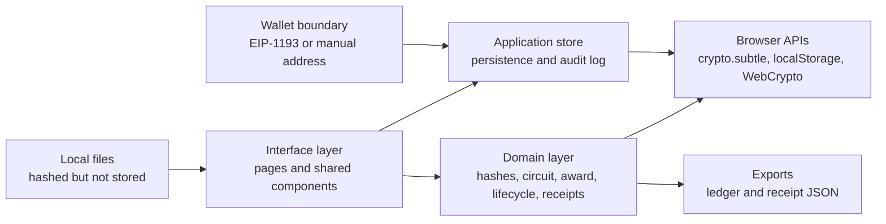

# Architecture

This document describes how Bidoraq is structured, where state lives, and which invariants the implementation protects.

## Scope

Bidoraq is a browser-only application. It has no application server, no remote database, and no on-chain write path. The React interface calls deterministic domain functions and stores resulting records in `localStorage`.

The architecture goal is to keep evidence creation inspectable: every record should be derived from a visible operator action and reproducible from the stored inputs.

## Runtime boundaries

## Component responsibilities

| Layer | Files | Responsibility |
| --- | --- | --- |
| Interface | `src/pages`, `src/components` | Render workflow views, collect operator input, and display derived state. |
| Routing | `src/App.tsx`, `src/main.tsx` | Map public and workspace routes to pages. |
| State | `src/state/store.tsx` | Own workspace state, wallet connection, persistence, and audit entries. |
| Domain | `src/lib` | Perform deterministic calculations and enforce lifecycle and evidence rules. |
| Types | `src/types.ts` | Define canonical record shapes shared by all layers. |
| Styling | `src/index.css`, `src/styles/tokens.css`, `tailwind.config.ts` | Define Evidence Ledger tokens and base styles. |
| Automation | `scripts`, `.github/workflows` | Validate behavior, visual state, links, dependencies, and security. |

## Data model

| Entity | Required fields | Purpose |
| --- | --- | --- |
| Profile | name, organization, email, onboarded | Local operator identity. |
| Tender | id, reference, title, policy, policyHash, bidders, status | Locked procurement brief and rule. |
| Bid | id, tenderId, bidder, priceKobo, documentHash, salt, commitment, status | Sealed quotation and reveal state. |
| EligibilityResult | inputs, bits, trace, result, circuitId, processor | Reviewer evidence and six-NAND output. |
| Award | tenderId, winningBidId, priceKobo, approvedBy, transactionHash | Final decision record. |
| AuditLog | actor, role, action, record, timestamp, reference | Trace of local writes. |
| ReceiptPayload | policy, policyHash, winner, ranked bids, approval metadata | Redacted evidence artifact for verification. |

Workspace versioning is explicit through `version: 2` and `STORAGE_KEY = 'bidoraq:workspace:v2'`.

## Domain functions

| Function | Module | Contract |
| --- | --- | --- |
| `computePolicyHash` | `crypto.ts` | Derives the locked policy hash from chain, verifier, tender identity, and policy fields. |
| `computeCommitment` | `crypto.ts` | Derives a sealed bid commitment from tender, bidder, price, document hash, and salt. |
| `verifyCommitment` | `crypto.ts` | Recomputes a commitment and compares it to the sealed value. |
| `hashDocument` | `crypto.ts` | Computes SHA-256 over uploaded file bytes in the browser. |
| `randomSalt` | `crypto.ts` | Generates a 32-byte browser randomness value for reveal. |
| `evaluateEligibility` | `circuit.ts` | Runs six NAND gates over four reviewer-attested bits and returns a trace. |
| `selectWinner` | `award.ts` | Ranks eligible revealed bids and identifies the compliant winner. |
| `canTransition` | `stateMachine.ts` | Determines whether a tender status transition is valid. |
| `buildReceipt` | `receipt.ts` | Builds a redacted receipt from tender, award, and revealed bids. |
| `verifyReceipt` | `receipt.ts` | Recomputes policy, winning commitment, and award rule checks. |

## Lifecycle invariants

- A tender policy hash never changes after publication.
- A bid cannot be committed after the commitment deadline.
- A reveal must reproduce the original commitment.
- An eligibility result exists only after four reviewer bits are recorded.
- A tender cannot skip lifecycle states.
- An award is valid only when the selected bid equals the computed winner.
- A receipt must never include supplier names or document contents.
- Uploaded document bytes must never be persisted.

## Failure handling

| Failure | Behavior |
| --- | --- |
| Late commit | Refused by deadline check. |
| Failed reveal | Rejected by commitment comparison and recorded as a reveal error. |
| Missing eligibility | No winner can be computed. |
| Non-compliant award | Refused by the approver action. |
| Invalid receipt JSON | Rejected by parser validation. |
| Tampered receipt fields | Verification checks fail visibly. |
| Invalid route | NotFound page renders. |

## Testing strategy

- Domain tests cover hashes, eligibility vectors, award ranking, and lifecycle transitions.
- Strict TypeScript catches shape drift across layers.
- Production build verifies bundling and asset generation.
- Playwright drives the complete workflow and asserts no overflow or browser errors.
- Link validation checks all repository markdown links and anchors.
- CodeQL and dependency review check source and dependency risk.

## Extension points

- Add new domain rules in `src/lib` with tests before exposing them in the interface.
- Add new pages under `src/pages` and register them in `src/App.tsx`.
- Add new receipt versions only with a parser branch and verifier coverage.
- Add new storage versions only with explicit migration behavior.
- Add new automation through `.github/workflows` using existing quality gates as the baseline.

## Related documents

- [README](../README.md)
- [Architecture decision records](adr/README.md)
- [Security policy](../SECURITY.md)
- [Privacy policy](../PRIVACY.md)
- [Roadmap](../ROADMAP.md)
